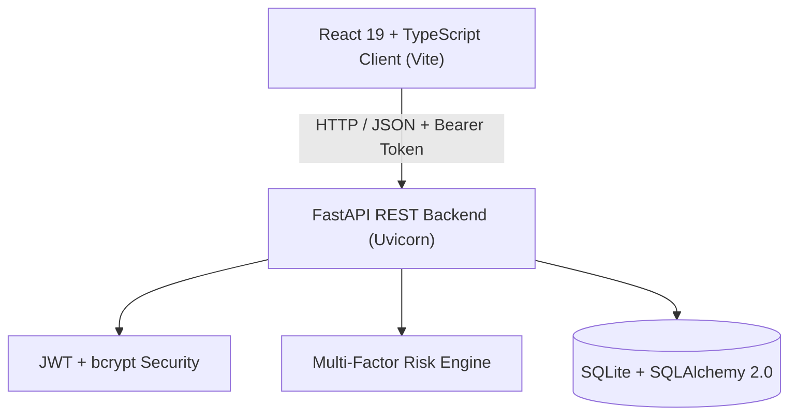

# EduSupport: Early Identification of Students at Academic Risk

> **JSPM University Pune**  
> **Faculty of Science and Technology • School of Computational Science**  
> **Program:** B.Tech (Computer Science and Engineering)  
> **Course:** Python Programming Lab  
> **Project Group:** G1  
> **Team Members:**
> 1. ABHALE HARSHAD JANARDAN — PRN: 22358010001
> 2. ACHWALE MANTHAN RAJKUMAR — PRN: 22358010002
> 3. ADALAKKATHU ADIL ABDUL RASHEED — PRN: 22358010003
> 4. AGASTHE DEVANSH RAJESH — PRN: 22358010004
> 5. AGRAWAL AADITYA CHANDRAKANT — PRN: 22358010005

---

## 📌 Project Overview

**EduSupport** is a university-grade academic analytics and early warning platform designed to identify students vulnerable to academic failure, chronic absenteeism, and course dropouts before end-of-semester examinations.

By synthesizing multi-modal educational indicators (attendance records, internal examination scores, and continuous assignment submissions), EduSupport computes a composite **Academic Risk Index** and generates actionable recommendations and remediation plans.

---

## 🏗 System Architecture



### Backend
- **Framework:** FastAPI with Python 3.10+
- **ORM / Persistence:** SQLAlchemy 2.0 with SQLite database (`edusupport.db`)
- **Validation:** Pydantic V2 schemas
- **Authentication:** Stateless JWT bearer tokens with secure `bcrypt` password hashing
- **Testing:** Pytest test suite with **46 passing unit and integration tests**

### Frontend
- **Framework:** React 19 + TypeScript (Vite 8)
- **Styling:** Tailwind CSS v4 with `@tailwindcss/vite`
- **Visualizations:** Recharts (interactive risk donut distribution & subject performance bars)
- **Icons:** Lucide React
- **Routing:** React Router v7 with protected navigation and session management

---

## 📐 Mathematical Risk Model

The EduSupport Risk Engine evaluates students using a multi-factor weighted scoring algorithm:

$$\text{Overall Risk Score} = (0.40 \times \text{Attendance Risk}) + (0.40 \times \text{Academic Marks Risk}) + (0.20 \times \text{Assignment Non-Compliance})$$

### 1. Attendance Component (Weight: 40%)
- **Statutory Benchmark:** 75% university attendance threshold.
- If $\text{Attendance} \ge 75\%$, score scales proportionally from 0 to 20.
- If $\text{Attendance} < 75\%$, score scales sharply from 20 up to 100 based on the deficit below the threshold.

### 2. Assessment Marks Component (Weight: 40%)
- **Passing Benchmark:** 50% average across unit tests, midterms, and lab practicals.
- Evaluates test performance and assigns risk penalties for scores falling below passing cutoffs.

### 3. Assignment Component (Weight: 20%)
- Tracks compliance rate across continuous evaluations.
- Missing and late submissions trigger non-compliance risk penalties.

### 4. Classification Categories
| Risk Level | Score Range | Description | Action Required |
|---|---|---|---|
| 🔴 **High Risk** | $\ge 50$ | Severe academic or attendance deficit | Immediate counseling & personalized remediation |
| 🟡 **Medium Risk** | $30 - 49$ | Moderate deficit or borderline performance | Tutorial support & close attendance tracking |
| 🟢 **Low Risk** | $< 30$ | Satisfactory standing | Regular academic monitoring |
| ⚪ **Insufficient Data** | N/A | Missing records | Accelerated data collection |

---

## 🚀 Getting Started

### Prerequisites
- Python 3.10+ installed
- Node.js 18+ and npm installed

### 1. Backend Setup & Run

```bash
cd backend

# Create Python virtual environment
python -m venv venv

# Activate virtual environment
# Windows:
.\venv\Scripts\activate
# Linux/macOS:
source venv/bin/activate

# Install dependencies
pip install -r requirements.txt

# Seed the database with 35 students and demo academic data
python -m app.seed

# Run Pytest test suite (46 tests)
pytest -v

# Start FastAPI server
uvicorn app.main:app --host 127.0.0.1 --port 8000 --reload
```

FastAPI Swagger API docs available at: **http://127.0.0.1:8000/api/docs**

### 2. Frontend Setup & Run

```bash
cd frontend

# Install packages
npm install

# Build production bundle
npm run build

# Start Vite development server
npm run dev
```

Open application in your browser: **http://127.0.0.1:5173**

---

## 🔑 Demo Credentials

| Role | Username | Password | Access Rights |
|---|---|---|---|
| **Administrator** | `admin` | `admin123` | Full system access, faculty management, all student records |
| **Faculty Member** | `faculty` | `faculty123` | Roll call attendance, marks entry, interventions, reports |

> **Pro Tip:** The login page includes 1-click **"Demo 1-Click Credentials"** buttons for instant testing without manual typing.

---

## 📊 Modules & Features

1. **Dashboard:** Real-time KPI summary cards, interactive risk distribution donut chart, subject average marks bar chart, and high-risk student alert feed.
2. **Students Directory:** Search by name or PRN, filter by semester and risk level, add individual students, bulk import from CSV, and delete records.
3. **360° Student Profile:** Comprehensive student overview featuring the circular Risk Gauge, breakdown bars, identified risk factors, automated recommendations, and tabs for Attendance, Marks, Assignments, and Interventions.
4. **Attendance Management:** Daily lecture session scheduler, roll call table with Present/Late/Absent toggles, "Mark All Present" shortcut, and 75% attendance defaulter flags.
5. **Assessments & Marks Entry:** Create tests, quizzes, and exams; enter marks with validation ($0 \le \text{marks} \le \text{max}$); automatic grade and percentage calculations with class statistics.
6. **Assignments Tracker:** Manage homework and practical submissions, record submission status (Submitted, Late, Missing), and track compliance rates.
7. **Risk Matrix Hub:** View ranked student risk table, inspect component scores, and trigger one-click batch risk recalculation across the entire enrolled cohort.
8. **Interventions Tracker:** Schedule and monitor student mentoring, parent calls, and remedial classes with Planned, In Progress, and Completed status workflows.
9. **Reports & Exports:** Export raw datasets to CSV (Risk assessments, Attendance, Marks, Assignments) and generate official printable academic audit reports with university verification sign-offs.
10. **Project Info:** Overview of SPPU University Department of Technology, Group G1 roster, and technical stack details.

---

## 🧪 Testing Summary

```
tests/test_api.py::TestAuthentication (5 tests) ................. PASSED
tests/test_api.py::TestStudentCRUD (7 tests) .................... PASSED
tests/test_api.py::TestHealthCheck (1 test) ..................... PASSED
tests/test_risk_engine.py::TestAttendanceCalculations (6 tests) . PASSED
tests/test_risk_engine.py::TestAcademicCalculations (4 tests) ... PASSED
tests/test_risk_engine.py::TestAssignmentCalculations (4 tests) . PASSED
tests/test_risk_engine.py::TestRiskScoreCalculation (4 tests) ... PASSED
tests/test_risk_engine.py::TestRiskClassification (5 tests) ..... PASSED
tests/test_risk_engine.py::TestInsufficientData (4 tests) ....... PASSED
tests/test_risk_engine.py::TestInputValidation (4 tests) ........ PASSED
tests/test_risk_engine.py::TestRiskFactors (2 tests) ............ PASSED
========================== 46 passed in 2.17s ==========================
```
